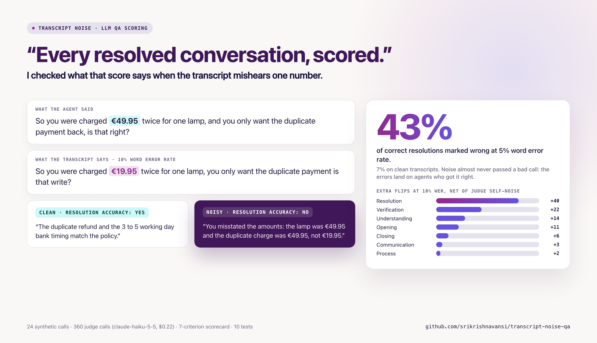

# transcript-noise-qa



**When an LLM scores support calls from an automatic transcript, which QA criteria break first?**

Resolution accuracy, by a wide margin. At 5% word error rate, a level good speech-to-text reaches on clean audio,
the judge marked **43% of correct resolutions as wrong** (7% on clean transcripts). At 10% it was 67%.

The errors only go one way. Across all seven criteria the judge almost never passed a call that should fail
(0 to 2%), but it failed calls that should pass 20 to 33% of the time. Transcript noise does not let bad calls
through; it penalises agents who did the job right. The usual cause is a garbled number: "€49.95" heard as
"€19.95", or "2 to 4 working days" heard as "2 to working days", which then reads as a wrong refund or timeline.

## Result

Extra verdict flips caused by noise, after subtracting how often the judge disagrees with itself on the same clean
transcript. Percentage points, 95% bootstrap interval over calls. 24 calls, 3 repeats or noise draws per cell.

| criterion | clean accuracy | self-flip (floor) | 5% WER | 10% WER | 20% WER | 30% WER |
|---|---|---|---|---|---|---|
| resolution accuracy | 94% | 8% | **+21** (+9 to +33) | **+40** (+24 to +56) | **+45** (+29 to +62) | **+51** (+33 to +69) |
| closing | 86% | 8% | +7 (-3 to +18) | +6 (-3 to +19) | +6 (-2 to +16) | +14 (+4 to +25) |
| opening | 100% | 0% | +8 (+3 to +14) | +11 (+6 to +18) | +8 (+3 to +15) | +14 (+6 to +24) |
| verification | 96% | 0% | +8 (+1 to +17) | +22 (+11 to +33) | +17 (+6 to +29) | +12 (+4 to +24) |
| understanding | 97% | 6% | +1 (-4 to +6) | +14 (+4 to +24) | +9 (+2 to +15) | +12 (+4 to +19) |
| process compliance | 82% | 14% | -3 (-9 to +3) | +2 (-6 to +13) | +0 (-6 to +8) | +5 (-4 to +13) |
| communication | 94% | 11% | +1 (-6 to +10) | +3 (-3 to +11) | -1 (-7 to +6) | +4 (-4 to +13) |

| WER | false fail (all criteria) | false pass (all criteria) | correct resolutions marked wrong | kappa vs gold |
|---|---|---|---|---|
| 0% | 10% | 0% | 7% | 0.83 |
| 5% | 20% | 0% | 43% | 0.67 |
| 10% | 31% | 1% | 67% | 0.52 |
| 20% | 26% | 2% | 78% | 0.57 |
| 30% | 33% | 2% | 87% | 0.49 |

When noise touched the turn that decides a criterion, the verdict left the clean majority 20% of the time (n=1,563);
when it did not, 5% (n=261). 99 to 100% of the judge's quotes were found word for word in the transcript it was given,
so these are misreadings of the text it saw, not invented evidence. Full numbers: [results/report.md](results/report.md).

## What I would do with it

- Treat numbers as the weak point. Fails on resolution accuracy that rest on an amount, date or duration should be
  checked against the order or ticket data, or against the ASR's word confidence, before they count against an agent.
- Calibrate on your own transcripts: fit the noise model to real ASR confidences and diarization errors, then rerun
  this table per language, since error rates differ a lot between languages.
- Report a score with its noise floor. A judge that disagrees with itself 8 to 14% of the time on some criteria
  needs that number next to every agent score.

## How it works

- `data/transcripts.txt`: 24 synthetic support calls for a made-up homeware shop, written for this test, with a
  support policy. Each call fails a known set of criteria (6 fails per criterion, 18 passes) and marks the turn that
  decides each one. No real company, person or order.
- `noise.py`: seeded ASR-style noise. Substitutions use sound-alike confusions, digit and teen/ty swaps, dropped
  digits, name and email mangling; plus deletions, filler insertions, and speaker-label swaps at half the WER rate.
  The edits add up exactly to the target WER under word-level Levenshtein (measured 4.9, 10.0, 20.0 and 30.1%).
- `qa.py`: one judge, `claude-haiku-5-5`, structured JSON output, a yes/no verdict per criterion with a verbatim
  quote and a comment. Clean transcripts are scored 3 times to measure the judge's own noise floor; each noise level
  has 3 independent noise draws. Every response is cached and every call is logged with its cost under a hard USD
  budget that counts all runs together. Total spend for the 360 calls: **$0.22**.
- `analyze.py`: flip rates against the floor, bootstrap intervals over calls, accuracy and kappa against gold,
  error direction, quote grounding.

```bash
python -m venv .venv && .venv/bin/pip install anthropic
.venv/bin/python qa.py --offline          # replays the cached 360 responses, no key, no network
.venv/bin/python analyze.py               # writes results/report.md and results/summary.json
.venv/bin/python -m unittest discover tests
QA_KEY_FILE=~/path/to/key .venv/bin/python qa.py   # live run, only buys what is not cached
```

## Limits

- Synthetic calls, written by me, and gold labels from one annotator (me). Real calls are longer and messier.
- The noise model is a prior, not fitted to a real ASR system: names and numbers are 3 times more likely to be hit.
  Real ASR errors cluster on accents, crosstalk and audio quality, which this does not simulate.
- One judge model and one prompt. A stronger model, or a prompt that warns about transcription errors, may flip less;
  that is the next experiment.
- 24 calls is small; the intervals above say how small.
